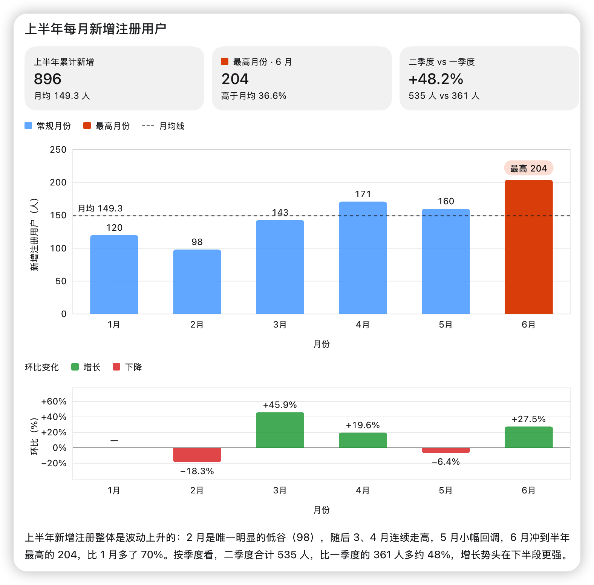

# Claude Codex 适配器

[English](README.md)

[](https://github.com/fuergaosi233/claude-codex/actions/workflows/ci.yml)
[](https://fuergaosi233.github.io/claude-codex/)
[](https://nodejs.org)

生产级 TypeScript 适配器，让 **Codex 桌面版**在 Remote 模式下通过原生 Codex `app-server` 协议与 **Claude Code** 对话。

Codex App 仍执行正常的 SSH 版本探测、引导和 `app-server proxy` 流程，但 `codex app-server` 由这个适配器接管，而不是真正的 Codex 运行时，因此 Agent 轮次实际运行在 Claude Code 上。

[](#视频介绍)

[观看视频介绍（含声音）](#视频介绍)

<p align="center">
  
</p>

<p align="center"><sub>在 Codex App 对话中让 Claude 绘制六个月的注册量图表，
Claude 用<a href="#内联可视化">内联可视化</a>作答，由 App 直接渲染在回复中。请求使用中文，图中标签也使用中文。</sub></p>

📖 **文档：<https://fuergaosi233.github.io/claude-codex/>**

## 视频介绍

https://github.com/user-attachments/assets/6892a0b6-4d30-42bd-96a3-89e380754075

[下载高清版和字幕](https://github.com/nwverse/claude-codex/releases/tag/promo-v1)

## 快速开始

```bash
npm install
npm run build        # tsc -> dist/ (production artifact)
npm run dev          # tsx src/adapter.mts — run sources directly, no build
npm run doctor       # environment self-check
```

> **需要 Node.js 24+**，以使用稳定的 `node:sqlite`。如果默认 Node 版本较低，
> 请通过 `CLAUDE_CODEX_NODE` 指定 Node 可执行文件。

然后在远程主机安装 `codex` shim，并在 Codex App 中添加 Remote 连接：

```bash
mkdir -p ~/bin
cp scripts/codex-shim ~/bin/codex && chmod +x ~/bin/codex
export PATH="$HOME/bin:$PATH"
export CLAUDE_CODEX_ADAPTER="$PWD/dist/src/adapter.mjs"
export ANTHROPIC_API_KEY="<your-anthropic-api-key>" # or authenticate with `claude /login`
```

凭据只能通过本地 shell 或密钥管理器提供。不要提交 API key、OAuth/会话数据、
`.env` 文件或验收测试日志。

完整步骤见 **[入门指南](https://fuergaosi233.github.io/claude-codex/guide/getting-started)**。

## 工作原理

```
Codex App ──SSH──▶ 登录 shell ──▶ codex（PATH 中靠前的 shim）
                                     │
                  app-server 调用 ───┘──▶ Claude Codex 适配器 ──▶ Claude Code
                  其他所有命令 ────────▶ 真正的 Codex CLI（CODEX_REAL）
```

Agent 文本和推理会流式进入对话，Claude 的思考显示为 App 的推理摘要
（`CLAUDE_CODEX_REASONING_VISIBLE=0` 可隐藏）；`Bash` 等工具变成命令审批；
`Edit`、`Write`、`MultiEdit` 变成带实时 diff 的文件修改审批；MCP 工具调用使用
App 的 MCP 工具审批卡。目前运行时选择只映射到已有后端路径：默认的进程内
Claude Agent SDK、`agent-http`、`agentapi`、`claude-p`、`codex-proxy` 和 `mock`。

App 通过 `codex app-server --listen unix://` 启动一个适配器守护进程，再经
`codex app-server proxy` 连接。两者都不指定 socket，因此默认使用
`$CODEX_HOME/app-server-control/app-server-control.sock`。要更改位置，请在登录
shell 或 `~/.claude-codex/runtime.env` 中把 `CLAUDE_CODEX_SOCKET_PATH` 设为独立
目录下的绝对路径，守护进程和 proxy 必须一致。详见
[配置](https://fuergaosi233.github.io/claude-codex/guide/configuration)。

每个 Claude 线程运行自己的 Claude Code 进程。多个线程同时启动时，例如适配器或
App 重启后所有对话同时恢复 Claude 会话，它们会并发写入用户的 Claude Code 配置
（`~/.claude.json`），可能损坏该文件
（[anthropics/claude-code#28847](https://github.com/anthropics/claude-code/issues/28847)）。
`CLAUDE_CODEX_SDK_LAUNCH_GATE=1` 会改为逐个启动：每个进程等待前一个进程发出首条
消息；如果一直没有消息，最多等待 `CLAUDE_CODEX_SDK_LAUNCH_GATE_TIMEOUT_MS`
（默认 30000）。其间发送的提示词和 steer 会等待对应进程。该开关默认关闭。

进程继承适配器环境，因此 Claude Code 自己的变量与终端中一样生效。例如
`CLAUDE_CODE_FORK_SUBAGENT=0` 可禁止 Claude 启动 fork 子 Agent
（`subagent_type: "fork"`）；从 2.1.302 起 Claude Code 默认向 Agent SDK 会话提供
fork，App 中显示为角色 `fork` 的子 Agent。使用模型进程配置时，只有配置的
`inheritEnv` 列出该变量或 `env` 设置它，变量才会传给对应配置。详见
[Claude Code 变量](https://fuergaosi233.github.io/claude-codex/guide/configuration#claude-code-variables)。

### 模型进程配置

默认情况下，所有 Claude 线程都使用适配器环境中的同一个 Claude Code。把
`CLAUDE_CODEX_MODEL_PROFILES_FILE` 指向配置文件（或用
`CLAUDE_CODEX_MODEL_PROFILES` 直接传入相同 JSON），选择器中的每个 Claude 模型
就会运行独立的 Claude Code 进程：有自己的可执行文件、提供方环境和 Claude 配置
目录，不携带适配器的提供方凭据。密钥保留在环境或私有环境文件中，配置文件只
引用它们。对话始终保持启动时的配置。配置修改后，或对于创建配置前的旧对话，
仍可打开阅读，但发送新消息会要求新建对话，而不是在其他地方恢复旧会话。未提供
配置文件时行为不变。文件格式、安全规则及其与 `CLAUDE_CODEX_MODELS` 的关系见
[模型进程配置](https://fuergaosi233.github.io/claude-codex/guide/configuration#model-process-profiles)。

### 桌面对话与可视化讲解

原生 Claude Agent SDK 后端会收到以 Claude Desktop 对话风格为参照的展示指导：
自然解释，复杂问题给出足够细节，按内容选择格式，而不是固定输出工程报告。提问
邀请讨论；行动请求仍使用并验证工具。进度更新说明有意义的状态变化，原生工具
事件保留执行细节。

这些指导描述 Codex 桌面版的 Markdown 和 Mermaid 渲染。适合图示的讲解会使用
`mermaid` 围栏代码块绘制流程图或时序图，简单回答仍保持简短，并遵循用户指定的语言和
格式。它补充 Claude Code 预设，不覆盖明确的项目、开发者或个性偏好。无需修改
全局 `~/.claude/CLAUDE.md`；受 schema 约束的轮次不接收这些展示指导。

渲染由所用的 Codex App 版本提供。适配器在流式输出和历史记录中保留 Markdown，
不捆绑图表渲染器或 Claude Desktop Artifacts 运行时。任意 HTML/React 代码块不会
变成交互应用（下面的内联可视化走 App 自己的沙箱）。旧客户端可能显示 Mermaid
源码而非图形。

### 内联可视化

与 Codex 线程一样，Claude 线程可以在对话中展示图表、图解和小型交互讲解，由
Codex App 自己的可视化沙箱渲染。适配器记住 App 启动时安装的 `visualize` 插件，
在系统提示中列出它的 skill、App 可渲染的 `::codex-inline-vis{path="…"}` 行以及
线程的可视化目录。需要时 Claude 读取该 skill，在那里写入 HTML 片段，并在回复中
引用它。

App 只为 Codex 签发的 UUIDv7 线程 ID 读取可视化。新线程、fork 和子 Agent 都会
获得这种 ID；此前创建的对话仍可使用，但不能渲染内联可视化。文件规则（小写连
字符 `.html` 文件名、位于线程目录或 `/tmp` 内的绝对路径、最大 5 MB）见
**[使用 Codex App](https://fuergaosi233.github.io/claude-codex/guide/gui#inline-visualizations)**。

### Pull Requests 面板

Codex App 的 Pull Requests 面板与内置 `code-review` 插件的 MCP 服务器通信，App
启动 app-server 时通过 `-c` 设置启用该插件。`CLAUDE_CODEX_APP_PLUGIN_MCP=1` 让
适配器为 App 自己的调用（`mcpServerStatus/list`、`mcpServer/tool/call`、
`mcpServer/resource/read`）运行该服务器：每个适配器一个长驻进程，从插件目录按
`.mcp.json` 命令启动，`CODEX_MCP_NODE_PATH` 指向 Node.js 可执行文件，仅传递少量
环境变量（`HOME`、`PATH` 等基础变量和插件列出的变量，排除名称看似凭据的变量）。
逗号分隔的插件名列表可用同样方式运行其他插件的服务器；`codex-app-tools` 和
`browser-use` 永不运行。此功能默认关闭，服务器也不会提供给 Claude 线程。

插件使用主机的 GitHub 凭据，例如已有 `gh` 登录；适配器不读取、记录或转发任何
令牌。从面板发起审查会运行 Codex CLI 自己的 `exec`，需要可用的 Codex 安装和登录；
插件基于 ChatGPT 的 GitHub 连接不可用，因为它会启动第二个 app-server。详见
**[使用 Codex App](https://fuergaosi233.github.io/claude-codex/guide/gui#pull-requests-panel)**。

### 项目指令

Claude 线程遵循与 Codex 相同的 `AGENTS.md`：先读 `CODEX_HOME` 中的全局文件
（优先 `AGENTS.override.md`），再从 git 根目录到线程目录逐层读取，总量遵守 Codex
的 32 KiB 项目预算。它们以 Codex 的框架进入 Claude 系统提示，App 也把它们列为
线程的指令来源。Claude Code 已通过 `CLAUDE.md` import 自行读取的文件不会重复发送。

Claude CLI 关闭设置来源时，设置 `CLAUDE_CODEX_CLAUDE_CONFIG_DIR`（通常是
`~/.claude`）即可带上这份 Claude Code 配置：用户和项目 `CLAUDE.md` 及其
`@imports`、`CLAUDE.local.md`、`.claude/rules/`（带 `paths:` 作用域的规则会在适用
时列出供 Claude 阅读），以及用户和项目 skills。该目录的 MCP 服务器、子 Agent、
权限规则和 hooks 只有各自开关打开时才携带（见下文），Codex 配置中的服务器也如此。

### 继承配置

`CLAUDE_CODEX_CODEX_MCP_SERVERS=1` 让 Claude 线程启动 Codex 配置中的 MCP 服务器：
`CODEX_HOME/config.toml` 的 `[mcp_servers.<name>]`，以及 Codex 信任的项目中的
`.codex/config.toml`。此功能默认关闭，因为 Codex App 会为 Codex 线程把桌面服务器
（如 computer-use 客户端和 Node REPL）写入 `config.toml`，否则它们会进入每个
Claude 线程。Stdio 服务器保留 `args`、`env`、`env_vars` 和 `cwd`；streamable HTTP
服务器保留 headers 和 bearer token。服务器配置通过仅用户可读的文件传给 CLI，文件
位于适配器 home 中并在 CLI 会话结束时删除，不放在任何本地进程都能读取的 CLI 命令行。
`env_vars`、`env_http_headers` 和 `bearer_token_env_var` 指定的值也不写入该文件：文件
以 `${NAME}` 引用它们，CLI 从适配器传来的环境中填充。因此，从允许列表重建 CLI 环境
的启动器会丢弃这些值；与任何服务器配置引用一样，它们不能使用 CLI 自己的凭据，也不
能使用 CLI 凭据列表中的远程凭据名（如 `VAULT_TOKEN` 或 `NPM_TOKEN`），否则会得到空值，
应为这种值换一个名字。直接写入 Codex 配置的值会原样传递，包括 `${...}`，与 Codex 的
行为一致。`enabled = false` 的服务器保持关闭，`disabled_tools` 不提供给 Claude，调用
`enabled_tools` 之外的工具会被拒绝，`tool_timeout_sec` 成为工具调用超时。Codex OAuth
登录、`startup_timeout_sec`、`required`、逐工具审批设置和插件带来的服务器不会传入
Claude 线程（App 自己的 Pull Requests 面板调用单独处理，见上文）。Claude Code 自己登录
MCP 服务器，Agent SDK 无法发起登录，因此 App 请求的登录会失败，而不是打开无效页面。
错误会提示在 Claude Code 会话中用 `/mcp` 登录；App 不显示错误文本，只显示无法连接。
每个新会话都会采用这种登录状态，客户端的 `config/mcpServer/reload` 可让仍打开的会话
重新连接。

设置 `CLAUDE_CODEX_CLAUDE_CONFIG_DIR` 且 `CLAUDE_CODEX_CLAUDE_MCP_SERVERS=1` 时，
Claude 线程会启动 Claude Code 服务器：全局配置文件（`~/.claude` 对应
`~/.claude.json`）中的用户级服务器和项目 local 级服务器，以及项目 `.mcp.json` 文件
（从仓库根目录到线程目录）中的服务器；后者要求项目受信任，且服务器已在用户自己的
设置中批准（`enabledMcpjsonServers` 或 `enableAllProjectMcpServers`）。Codex 信任该项目，
或用户已在 Claude Code 中为项目本身接受信任对话框，项目才受信任；这里指仓库主检出
（worktree 共享它）或仓库外目录，信任上层目录不算。检出的 `.git` 文件归该检出写入，
只有 git 自己的记录能证明链接时，它才指向主检出：该仓库 `.git/worktrees` 中此 worktree
的目录必须回指它。检入仓库的 `.claude/settings.json` 不能批准服务器；检入的
`.claude/settings.local.json` 也不能（无论路径采用何种大小写，因为文件系统可能忽略大小写
而 git 不忽略），通过仓库根目录下任意符号链接到达的同样不能；git 不认可 `.git` 文件链接
的检出也不行，因为此时文件来自仓库而非用户。服务器的 `${VAR}` 引用留给 CLI 从自身环境
填充，与 CLI 自己的配置文件一致；local 级服务器的 `headersHelper` 只在受信任项目中运行。
同名时 Claude Code 服务器优先于 Codex 服务器，`CLAUDE_CODEX_MCP_SERVERS` 优先于两者。
这些服务器仅用于线程自己的轮次，不用于摘要或其他内部轮次；App 的 MCP 面板列出所查询
线程的服务器。

`CLAUDE_CODEX_CLAUDE_AGENTS=1` 还会从桥接的 Claude Code 目录带上子 Agent：先读该目录的
`agents/*.md`，再读从 git 根目录到线程目录的 `.claude/agents/*.md`，同名时项目 Agent
优先于用户 Agent。`name`、`description`、`tools`、`disallowedTools`、`model`、`skills`、
`maxTurns`、`effort`、`memory`、`background`、`initialPrompt`、`autoCompactWindow` 和具名
`mcpServers` 会携带；`permissionMode`、`hooks` 和内联服务器定义不会，因为由 Codex 审批
策略决定什么可以运行。

`CLAUDE_CODEX_CLAUDE_PERMISSIONS=1` 时权限规则也会生效。用户 `settings.json` 和项目
`.claude/settings.json`、`.claude/settings.local.json` 中的 `permissions.deny` 始终生效：
无论审批策略如何，被拒绝的工具仍拒绝。`permissions.ask` 也一样：CLI 不接受设置文件之外
的 ask 规则，因此适配器注册 `PreToolUse` 回调，把匹配调用送到 Codex 审批提示，即使 allow
规则或 hook 本可批准。匹配方式与 Claude Code 相同，并倾向询问：Bash 规则覆盖复合命令行的
每条命令以及 `timeout`、`xargs`、`sh -c` 等包装器实际运行的命令；带命令替换、heredoc 或
变量命令名的命令行在任何 Bash 规则下都要询问，因为它可能运行任何内容；`Edit` 规则覆盖
所有编辑文件的工具，`Read` 规则按搜索目录覆盖 `Glob` 和 `Grep`。Full Access 下提示会自动
批准；plan 模式下被要求询问的调用会拒绝。`permissions.allow` 让匹配调用无需 Codex 审批即可
运行：用户规则始终生效，项目规则仅在项目受信任后生效（仓库提供的 `settings.local.json`
规则永不生效）；plan 模式或只读沙箱中均不生效，因为 Codex 本就不会允许这些工具未经询问
运行。用户规则中的 `/path` 与 Claude Code 一样相对于配置目录。审批卡保存的规则（“允许类似
命令”、“始终允许”；见[审批](docs/guide/gui.md#approvals)）写入项目
`.claude/settings.local.json`，因此项目受信任后在这里生效。`defaultMode` 和
`additionalDirectories` 不继承，模式和目录由 Codex 审批策略及沙箱决定。

命令 hooks 也只有明确请求时才运行：它们通常是终端会话的状态或通知集成，在每个 App 对话中
运行会悄悄改变行为（等待输入的 hook 甚至会卡住轮次）。`CLAUDE_CODEX_CLAUDE_HOOKS=user`
运行桥接目录 `settings.json` 中的 hooks；`=project` 还运行受信任项目
`.claude/settings.json` 和 `.claude/settings.local.json` 中的 hooks，仓库不会仅凭自身声明
运行命令；未设置、`0` 或其他值都不运行。此时 Claude CLI 必须按桥接目录的预期以关闭设置
来源的方式启动，否则 CLI 会再次运行同一 hooks。适配器启动时会警告；未设置
`CLAUDE_CODEX_CLI` 时会明确警告，因为 SDK 启动的 CLI 会读取所有来源。适配器不修改这些来源，
直接启动的 CLI 仍需要它们提供提供方设置。支持 `PreToolUse`、`PostToolUse`、
`PostToolUseFailure`、`UserPromptSubmit`、`Stop`、`SubagentStart`、`SubagentStop`、
`SessionStart`、`SessionEnd` 和 `Notification`。适配器向 Claude Agent SDK 注册每条命令；CLI
按 settings hook 匹配，适配器按 Claude Code 的方式执行：`sh -c`（`shell: "bash"` 时用
`bash -c`；带 `args` 的 exec 形式不经过 shell），hook JSON 从 stdin 输入，设置
`CLAUDE_PROJECT_DIR`，遵守 `timeout`（默认 10 分钟，`UserPromptSubmit` 30 秒，`SessionEnd`
1.5 秒）和 `async`。同一会话的 `SessionEnd` hooks 共用一个预算，取各超时中最长值，范围从
1.5 秒到一分钟；`CLAUDE_CODE_SESSIONEND_HOOKS_TIMEOUT_MS` 同时设置两者，与 Claude Code
一致。hook 的 `if`（如 `Bash(git *)` 权限规则）按适配器匹配 ask 规则的方式匹配工具调用，
无法拆分的命令行也会运行 hook；与 Claude Code 一样，非工具事件上的 `if` 使 hook 永不运行，
`once` 只对 skill 或 Agent 定义的 hook 有意义，在 settings 文件中无效。hook 自身进程退出即
完成；它启动的后台进程会继续运行并可写输出，超时 hook 则会连同它启动的所有进程一起终止。
退出码 0 传递 JSON 输出（普通输出成为 `UserPromptSubmit` 和 `SessionStart` 的上下文），退出码
2 阻止操作并以 stderr 为原因（`SubagentStart`、`SessionStart`、`SessionEnd` 只显示 stderr，
`Notification` 不做处理），其他退出码是非阻塞错误，`disableAllHooks` 关闭全部 hooks。
`onFailure: "block"` 与 Claude Code 一样采用失败关闭：无法启动、超时、以 0 和 2 之外的代码
退出或输出无法解析的 JSON 时，按退出码 2 处理，原因包含 hook 名和失败信息；异步 hooks 及
`Stop`、`SubagentStop` hooks 忽略它。plan 模式或只读沙箱中 hook 仍可拒绝或要求询问，但批准
会被丢弃，最终交给 Codex。

新会话、恢复会话或 fork 会话的 `SessionStart` hooks 在 SDK 注册回调前运行，`SessionEnd`
在 SDK 释放回调后运行，因此这两个由适配器自己执行：会话收到首个提示词后运行一次
`SessionStart`，来源 `startup`、`resume` 或 `fork` 按 CLI 的方式匹配，其上下文和
`systemMessage` 随提示词传给 Claude 和用户；接受过提示词的 CLI 会话结束时，以 `other`
为原因运行 `SessionEnd`。适配器停止时仍打开的会话也随之结束：所有这类会话的 hooks 在
适配器退出前运行，并像单个 CLI 一样共享一个预算。CLI 自己仍为 `compact` 和 `clear` 运行
`SessionStart`。提示词、Agent 和 HTTP hooks、PowerShell hooks、`asyncRewake` 唤醒、
`CLAUDE_ENV_FILE` 以及其他事件（如回调无法回传输出的 `PreCompact`，或由 Codex 审批流程
接管的 `PermissionRequest`）不会继承。`CLAUDE_CODEX_CLAUDE_CONFIG_DIR` 只能指向 CLI 自己
不会读取的目录，否则 hooks 会运行两次。

`CLAUDE_CODEX_CODEX_NOTIFY=1` 时，Claude 线程轮次完成会运行
`CODEX_HOME/config.toml` 的 `notify` 程序，与 Codex 自己的轮次一致：配置 argv 加一个 JSON
参数，`{"type":"agent-turn-complete", "thread-id", "turn-id", "cwd", "client",
"input-messages", "last-assistant-message"}`。此功能默认关闭，因为 Codex App 会把
`notify` 设为 Codex 线程的轮次结束程序，否则每个 Claude 轮次后也会调用它。适配器不等待
程序，30 秒后终止，并把 stderr 写入调试日志。摘要和其他内部轮次以及 Codex 模型线程
（由 Codex 自己运行）不通知；项目 `.codex/config.toml` 不能设置它。

通过 `config/value/write` 或线程启动配置设置的 `model_auto_compact_token_limit` 会成为
Claude 线程的 Claude Code 自动压缩窗口（`CLAUDE_CODE_AUTO_COMPACT_WINDOW`，限制在
Claude Code 接受的 100,000 到 1,000,000 tokens），优先于 Claude Code 自己的设置。
`CLAUDE_CODEX_CODEX_AUTO_COMPACT=1` 时，`CODEX_HOME/config.toml` 或受信任项目
`.codex/config.toml` 中的该键也生效。此功能默认关闭，因为用户通常为 Codex 模型设置该键，
否则会在每个 Claude 线程替换他们的 Claude Code 窗口。未设置时保留 Claude Code 自己的窗口。
详见**[配置](https://fuergaosi233.github.io/claude-codex/guide/configuration#context-compaction)**。

### 主对话

`CLAUDE_CODEX_LEADER_TOOLS=1`（默认关闭）时，你启动的对话中的 Claude 会获得
`codex_leader` MCP 服务器，其工具可启动其他 Claude 对话（`thread_start`）、列出
（`thread_list`）、等待（`thread_wait`）、发送消息（`thread_prompt`）和读取
（`thread_read`）。每个新对话都是 Codex App 侧栏中的普通对话，可打开继续交流。Claude
复述 `thread_start` 返回的行时，回复会显示对应对话卡片，与 Codex 启动的对话一致。新对话
继承主对话权限且不会更多，不能再作为主对话；主对话最多同时运行
`CLAUDE_CODEX_LEADER_MAX_RUNNING`（默认 4）个对话，也不会替它们回答审批或提问，这些仍
由你处理。这些工具需要原生 Claude Agent SDK 后端；详见
**[使用 Codex App](https://fuergaosi233.github.io/claude-codex/guide/gui#leader-chats)**。

### `/workflows` 兼容性

使用原生 Claude Agent SDK 后端时，`/workflows <task>` 会转换为 Claude 的 `ultracode:`
workflow 触发词。Workflow 任务事件以 Codex 原生、可审查的子 Agent 线程呈现。本地 workflow
运行时，适配器跟踪其 journal，并通过 Codex 原生 `subAgentActivity` 生命周期（`completed`
只发给声明支持的客户端）以及 `spawnAgent`/`wait` 工具状态映射每个内部 Agent；没有 journal
元数据的运行时在 workflow 到达终态后退化为一个聚合 workflow Agent。每个内部 Agent 的线程
以其 workflow 标签命名，没有标签则用任务首行。单独的 `/workflows` 列出当前 Codex 线程记录
的 workflow 运行。

等待子 Agent 或 workflow 的轮次，只有在 `CLAUDE_CODEX_SUBAGENT_TIMEOUT_MS`（默认 30 分钟；
`0` 为永不放弃）内完全没有收到其消息时才放弃。任何活动迹象（Agent 输出或工具心跳、任务
进度、workflow Agent 启动或结束）都会重新计时，因此长时间但健康的 workflow 能运行到结束。
等待用户期间暂停计时，电脑休眠时间不计。最终放弃时轮次失败，卡住的 Agent 停止；已交接的
后台 Agent 继续运行。详见
[配置参考](https://fuergaosi233.github.io/claude-codex/guide/configuration#reference-table)。

子 Agent 线程会随工作推进显示其消息、思考和带结果的工具调用，并保存在该线程中；父对话
不显示这些内容。`CLAUDE_CODEX_SUBAGENT_ITEMS=0` 可让子 Agent 线程只保留提示词和答案。

此兼容层仅适用于原生 Claude Agent SDK 后端。其他 HTTP、agentapi 和 `claude -p` 后端没有
workflow 事件桥。暂停、恢复、停止和保存等交互式 workflow 管理操作尚未实现。

选择 Codex Full Access 时，适配器让 Claude 保持标准权限模式，并通过现有 Codex 桥自动批准
权限请求。这避免 Relay 在可识别容器沙箱之外拒绝危险权限绕过，同时保持 Full Access 轮次
零提示。在适当隔离的环境中，运维者仍可显式设置
`CLAUDE_CODEX_PERMISSION_MODE=bypassPermissions`，选择原生 SDK bypass。

## 当前版本边界

- **生产路径：** TypeScript app-server 适配器仍是 Codex 桌面版 Remote 模式和 Claude Code 的交付路径。
- **Rust-first 工作：** 已包含 RFC、workspace 脚手架、协议 fixtures、解析/重新序列化测试和固定 fixture 漂移检查。Rust 尚未替代生产运行时、传输层、存储或启动器。
- **提供方与 Agent 循环：** 已实现描述符、脱敏的 `config/read` 投影和显式提供方/循环选择。选择仅是已知描述符的元数据与路由，映射到现有运行时后端，不新增可执行的提供方循环。
- **凭据模型：** 使用用户本地持有的 API key、官方云提供方凭据链、同一主机上的本地 CLI 登录，或由组织管理且负责计费、策略、审计和提供方合规的网关。
- **不支持：** 个人订阅 pooling、浏览器 cookie 或会话令牌复用、凭据共享、私有端点使用、绕过提供方的行为，以及声称拥有不存在的权限。
- **发布检查：** CI 运行 `npm run check`、`npm run typecheck`、`npm test`、`cargo test --workspace` 和固定 Rust fixture 漂移检查。文档变更应运行 `npm run docs:build`；需要凭据的 smoke 和验收检查仍为可选项，使用用户或组织持有的凭据。

验证矩阵和审查清单见
**[发布就绪参考](https://fuergaosi233.github.io/claude-codex/reference/release-readiness)**。

## 文档

| 主题 | 链接 |
| --- | --- |
| 入门 | <https://fuergaosi233.github.io/claude-codex/guide/getting-started> |
| 部署（远程主机） | <https://fuergaosi233.github.io/claude-codex/guide/deployment> |
| 使用 Codex App | <https://fuergaosi233.github.io/claude-codex/guide/gui> |
| 配置 | <https://fuergaosi233.github.io/claude-codex/guide/configuration> |
| 后端 | <https://fuergaosi233.github.io/claude-codex/guide/backends> |
| 能力矩阵 | <https://fuergaosi233.github.io/claude-codex/reference/capability-matrix> |
| Workflow 运维 | <https://fuergaosi233.github.io/claude-codex/reference/workflow-operations> |
| 发布就绪 | <https://fuergaosi233.github.io/claude-codex/reference/release-readiness> |
| 贡献 / 工具链 | <https://fuergaosi233.github.io/claude-codex/contributing> |
| 安全策略 | [SECURITY.md](SECURITY.md) |
| 安全示例 | [examples/](examples/) |

文档源码位于 [`docs/`](docs/)，通过 VitePress 发布。仓库还为贡献者提供渐进式
`AGENTS.md`（根目录、`src/`、`scripts/` 和 `test/`）。

## 开发

```bash
npm run dev          # run from TypeScript via tsx
npm run typecheck    # tsc --noEmit
npm run check        # biome format + lint
npm test             # build + node --test
npm run docs:dev     # preview this documentation site
```

完整工具链和约定见
**[贡献指南](https://fuergaosi233.github.io/claude-codex/contributing)**。

## Workflow 运维

适配器为长时间运行的 Codex 维护循环提供一个小型 workflow 控制面。它刻意采用文件
存储并保持显式：调度器在 `~/.codex/claude-codex-adapter/workflow-state.json` 跟踪
任务，任务只有入队并租出后才运行。

```bash
npm run workflow -- status
npm run workflow -- health
npm run workflow -- enqueue --id task-id --prompt "Do one concrete task"
npm run workflow -- schedule --worker codex-heartbeat
npm run workflow -- heartbeat --task task-id --worker codex-heartbeat
npm run workflow -- complete --task task-id
```

周期性心跳在继续工作前应使用 `health`。健康循环没有过期租约、没有失败任务，并且
没有运行中任务，或只有一个租约有效的运行中任务。租约仍有效时继续该任务，只有确实
需要更多时间才续心跳。不要重复入队。

运行事件默认追加到 `~/.codex/claude-codex-adapter/runs.jsonl`。注册表写入前会脱敏
提示词类字段、模型回复和看似密钥的值。`CLAUDE_CODEX_RUN_LOG=0` 可关闭日志，
`CLAUDE_CODEX_RUN_LOG=/path/log` 可选择其他 JSONL 文件。

可选的逐线程 worktree 隔离由 `CLAUDE_CODEX_WORKTREE_ROOT` 控制。线程 ID 映射为限制在
根目录内且抗冲突的标签，已有 worktree 会复用。worktree 设置失败时，适配器记录失败并
保留原 cwd，让 app-server 会话继续。

GitHub issue 或 PR 自动化必须经过信任边界队列。只把可信元数据导出到本地 JSON，再导入：

```bash
gh issue list --json number,title,state,url > /tmp/github-issues.json
npm run workflow -- ingest-github --github-json /tmp/github-issues.json
```

导入步骤只根据 `number`、`title`、`state`、`url` 和条目类型创建显式 workflow 任务。
正文、评论、review 和其他外部指令会有意排除在生成的提示词之外，后续 Agent 必须先通过
项目信任边界 workflow 检查外部文本，再修改代码。

## 许可证

[MIT](LICENSE)
